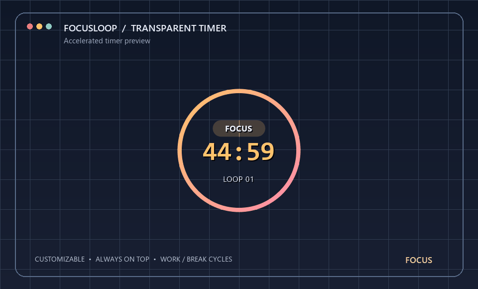
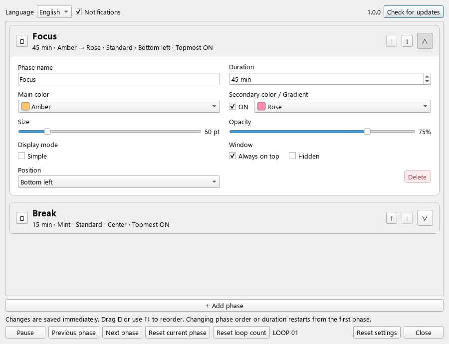

# FocusLoop

**A lightweight, transparent desktop focus timer for Windows, with fully customizable work and break cycles.**

**English** | [日本語](README.ja.md)

FocusLoop displays a click-through countdown over your desktop, switches between phases automatically, and stays out of your way.

## See it in action



*Accelerated demo using the actual FocusLoop timer rendering on a simulated desktop background.*

### Settings preview



## Download

**[Get FocusLoop for Windows from GitHub Releases](https://github.com/ochreotter/FocusLoop/releases)**

1. Download **`FocusLoop-Windows.zip`** from the latest published release.
2. Extract the ZIP.
3. Run **`FocusLoop/FocusLoop.exe`**.

Python is **not** required for the packaged Windows app. Keep the entire extracted `FocusLoop` folder together, including `_internal` and its DLLs.

> **Windows SmartScreen:** The EXE is currently unsigned, so Windows may display a warning.

## Features

- **Automatic focus/break cycles.** Defaults to **45 minutes of work** followed by **15 minutes of break**, repeated indefinitely. Add, delete, or reorder phases as needed.
- **Transparent, click-through overlay.** No opaque background panel; interact with apps underneath. Position the timer in any corner or the center.
- **Animated circular progress ring.** A smooth countdown ring (up to 30 FPS), with the phase name above the time and the loop number below it.
- **Two display modes.** Choose the standard ring view or a minimal **Simple** mode showing only the countdown.
- **Per-phase customization.** Set a name, duration (1–240 minutes), color (seven presets), optional two-color gradient, font size (8–300 pt), opacity (0–100%), position, always-on-top behavior, and visibility.
- **System tray controls.** Pause/resume, move to the previous or next phase, reset the current phase or loop count, open settings, or quit.
- **One instance per user.** Running FocusLoop again while it is in the system tray opens the existing settings window instead of launching another timer.
- **Per-phase notifications.** Enable or disable Windows notifications separately for each phase. The setting applies when that phase starts, including automatic transitions and manual skips. Existing global notification preferences are migrated automatically.
- **English and Japanese UI.** Switch languages instantly without resetting the timer. Phase names are never automatically translated.
- **Settings saved automatically.** Changes take effect immediately and persist across launches.
- **In-app updates.** Check GitHub Releases, verify the downloaded Windows package, and restart into the new version, with rollback attempted on failure.
- **Safer settings navigation.** Mouse-wheel scrolling does not accidentally change dropdown selections or duration values.

## Default phases

| Setting | Work | Break |
| --- | --- | --- |
| Duration | 45 minutes | 15 minutes |
| Main color | Amber | Mint |
| Gradient | Rose (enabled) | Disabled |
| Font size | 50 pt | 300 pt |
| Opacity | 30% | 20% |
| Display mode | Standard | Standard |
| Position | Bottom left | Center |
| Always on top | On | On |
| Overlay hidden | Off | Off |

All settings can be customized per phase.

## How to use

- **Left-click the tray icon** to open settings.
- **Right-click the tray icon** to access timer controls.
- **Drag the ⠿ handle**, or use a phase card's up/down buttons, to reorder phases.
- **Edit a phase** to change its duration, appearance, visibility, and position.
- **Click Close** when finished. Changes are saved immediately; there is no Apply button.
- **Use Reset settings** to restore the defaults after confirming the action.

Changing phase order or duration restarts from the first phase. Appearance changes preserve the remaining time. A **Hidden** phase continues running without displaying the overlay.

## Updating the Windows app

Click **Check for updates** in settings. FocusLoop queries the latest *published, non-prerelease* GitHub Release and asks for confirmation before downloading a newer version.

The updater checks the ZIP's size and SHA-256 digest, validates its contents, stages the new installation beside the existing folder, and uses a separate PowerShell process to replace the folder after FocusLoop exits. It then launches the updated app and attempts to restore the old version if the update fails.

**Requirements and limitations:**

- Automatic replacement works only in the packaged **Windows onedir EXE** (with `FocusLoop.exe` and `_internal`).
- The **parent directory of the installation must be writable**. Protected locations such as `Program Files` may prevent updates.
- Running from Python source or on other operating systems does not support automatic replacement.
- The entire installation folder is replaced. Do not store personal files in it.
- Update checks are manual; FocusLoop does not check automatically on startup.

## Run from source

Python 3.11 or later is required. On Windows:

```powershell
python -m venv .venv
.venv\Scripts\Activate.ps1
python -m pip install -r requirements.txt
python main.py
```

Run the unit tests:

```powershell
python -m unittest discover -s tests -v
```

For packaging and release checks, see the [release guide](docs/releasing.md). Bugs, suggestions and contributions are welcome via [GitHub Issues](https://github.com/ochreotter/FocusLoop/issues).

## License

FocusLoop's original source is released under the [MIT License](LICENSE). The distributed app also includes third-party software such as **PySide6/Qt**, with separate licensing obligations. See [Third-Party Notices](THIRD_PARTY_NOTICES.md) and the [library replacement guide](docs/library-replacement.md).

*For detailed Japanese documentation, see [README.ja.md](README.ja.md).*
